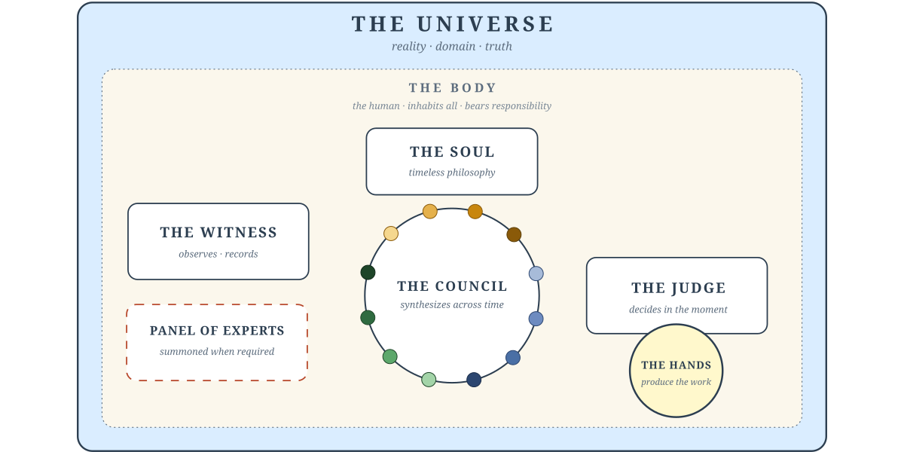

# Soul System

A living philosophy and operational framework for human-AI collaborative work
in research, science, engineering, and coding.

Not a prompt collection. Not a workflow template. A measured system: **one plain
page the AI reads** (about ten rules), **four instruments with teeth** (a capture
command, a completion gate, a handoff, a distiller), and **a book for humans**
(the philosophy that produced them). 2.0 is the shape the measurements left
standing — a program of pre-registered twin-chain experiments showed the frontier
model has absorbed this system's reasoning core; what it still cannot do is keep
its project history honest or carry what it learned across sessions. So that is
what the system does: a conscience and a notebook.

<p align="center">
  
</p>

*The role model above is the **human-facing** layer since 2.0: names for perspectives
that arise naturally in careful work, kept as a reading lens and a record vocabulary.
The AI reads one page (`operations/CLAUDE.md`); people read `philosophy/the-soul.md`.*
*The Body — the human — inhabits all of it and bears responsibility for the whole.*

**Composes, does not replace.** The Soul System layers above how you already work — BMAD, TDD, Cursor Rules, your own conventions. Adopt what helps. Ignore what does not.

---

## Quick Start

Two commands in Claude Code, in any project:

```
/plugin marketplace add soul-system-works/Soul-System
/plugin install soul-system@soul-system
```

Then, in the project you want to bring under the Soul:

```
/soul-init
```

That's the whole install. The plugin ships everything: the **contract** (the one
page the AI reads, wired in by `/soul-init` as an `@import`), the **commands**
(`/soul-*`, namespaced as e.g. `/soul-system:soul-capture`), and the
**pre-completion verification hook** (the gate that blocks unverified "done").
`/soul-init` also asks one register question — plain or fluent language; plain is
the default — offers an optional development stage (`/soul-stage`: what may be
broken, what must be kept), and scaffolds the project's record files. Optional,
any time: `/soul-delegate` lets a plan's routine steps go to another model (a
local model, Codex, a smaller Claude) while the AI re-runs every step's check
itself.

**What happens after install — who does what, and when:**
[`docs/using-the-soul.md`](docs/using-the-soul.md), one page.

---

## For developers (clone)

If you want to read, edit, or contribute to the system itself — or pin the
contract to a path you control — clone the repo to a stable location and let
`/soul-init` write the import against your clone instead (it derives the root
from wherever its skill is installed). Contract edits in a clone propagate
immediately to every project that imports it. The seed and the instruments
compose: adopt the contract alone, the plugin alone, or both.

---

## Other Agent Tools

`AGENTS.md` at the repo root is a cross-vendor convention (Cursor, Aider, OpenAI Codex, Gemini CLI, Jules, Zed, others) that points any agent tool at the right entry points. Soul-following projects are legible to any tool that reads `AGENTS.md`.

### Codex preview (experimental)

The repository also packages the shared skills for local Codex use. From a
stable clone of this repository, with a Codex client supporting plugin commands:

```bash
codex plugin marketplace add /absolute/path/to/Soul-System
codex plugin add soul-system@soul-system-codex
```

Restart Codex, open the adopting project, and invoke `$soul-system:soul-init`. This adds a
managed live-contract reference to `AGENTS.md` (or `AGENTS.override.md`) and uses
the same project records as Claude. Existing instructions are preserved. Review
and trust the plugin hooks in the host before relying on automatic verification;
installation alone does not arm them. Python 3 is required; Git enables shell-edit
detection. Run `$soul-system:soul-resume` after upgrades to check for stale contract paths.

Exercised with `codex-cli 0.163.0`: in one live `codex exec` session (2026-10-19)
the SessionStart hook delivered the contract, and the completion gate blocked once,
the model then ran the code, and the hook recorded its flagged and verdict events.
The trust-hooks prompt appeared in the owner's interactive runs. **CLI only:**
other clients (desktop, IDE, cloud) are untested. This is a local
preview, not a claim of desktop/IDE/cloud parity or public-directory eligibility.
See the [implementation and review report](docs/specs/codex-plugin-investigation.md)
for evidence and remaining checks, and [Codex host integration](operations/codex.md)
for skill behavior and detector limits. Current OpenAI guidance excludes hooks
from public-directory submissions; manual desktop installation is the documented
hook distribution route.

---

## Start

1. Open a session in your project — the contract page is all the AI needs.
2. When you want to understand *why* the system is shaped this way, read
   `philosophy/the-soul.md` — it is written for you, not the model.
3. The release post — what this does for you, what it won't, each claim
   anchored to a measured result — is in `docs/study/blog-release.md`.

---

## After Your Run

Read the Witness log. Not the output — the log.
If you found something worth sharing, see `CONTRIBUTING.md`.

---

## Structure

```
philosophy/     The Soul — the human-facing book (the AI does not read this)
operations/     The contract page — imported by @ into your project's CLAUDE.md
skills/         The /soul-* instruments, as Claude Code skills (invoked /soul-capture, …)
hooks/          Activation instruments — the pre-completion Stop hook + plugin hooks.json
amendments/     Amendments to the Soul, by lifecycle state (accepted/proposed/returned)
findings/       Findings, open/ and closed/
witness.md      The repo's own Witness log (what happened, backward)
ideas.md        The idea inbox (what might, forward) — graduates into findings/
mind.md         Optional project layer — project notes distilled from the record (unguessables only)
docs/           Live design specs + study/ (the measurements behind 1.0 and 2.0); historical provenance under docs/archive/
.claude-plugin/ Plugin + marketplace manifests (install the /soul-* skills + hook)
.codex-plugin/ Codex preview manifest (shares skills; uses hooks/codex.json)
.agents/plugins/ Codex preview marketplace catalog
AGENTS.md       Cross-vendor entry point for any agent tool
```

---

## Governance · Contributing · License

See `GOVERNANCE.md`, `CONTRIBUTING.md`, and `LICENSE` (MIT).

*The philosophy evolves. That is the point.*
